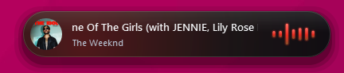
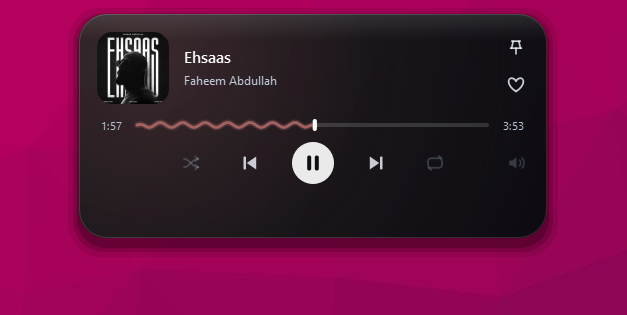
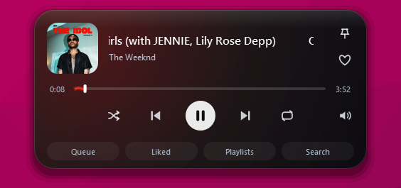
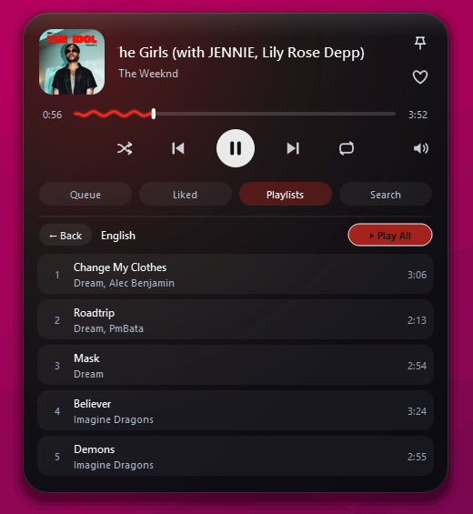
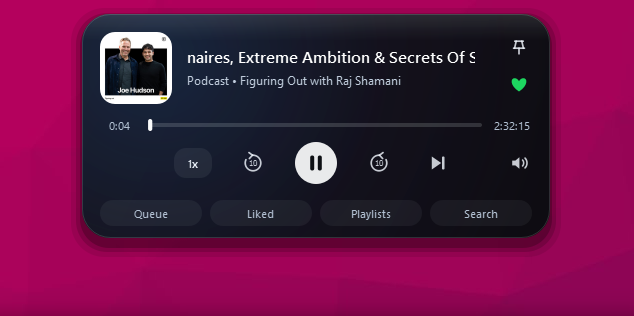

# Spotify Now Bar for Windows

A lightweight, native **Samsung One UI 7–style floating Now Bar** built exclusively for **Spotify on Windows 11**. Designed to run smoothly on integrated graphics (~40–55 MB RAM, ~0% CPU when hidden) with zero Electron or Rainmeter overhead.

## Demo
https://github.com/user-attachments/assets/36456edc-6d9c-480d-b22c-ca43db88b45a


<!-- Drag and drop LumiSnap_20261124_110842.mp4 here in the GitHub web editor -->

## Screenshots

| Compact Pill (Auto-Peek) | Local SMTC Mode (Zero Setup) |
| :---: | :---: |
|  |  |

| Expanded Player (Hybrid Mode) | Playlists & Library Drawer |
| :---: | :---: |
|  |  |

| Podcast Mode |
| :---: |
|  |

## Features

* **Top-Center Spring Drop-Down:** Rests as a click-through 3.5px dynamic glow bar at the top-center of your screen; hover for 150ms to drop down.
* **Auto-Peek & 7-Bar Visualizer:** Briefly glides down on track changes with a glowing harmonic waveform, then tucks away automatically.
* **Dynamic Album-Art Tinting:** Extracts vibrant accent colors from every cover and crossfades the frosted glass glow.
* **Animated Wavy Progress Slider:** Squiggly One UI-style progress bar while playing that flattens smoothly when paused or scrubbing.
* **Swipeable Drawer (`Queue` • `Liked` • `Playlists` • `Search`):**
  * **Queue:** Slide right (`→`) to play now, slide left (`←`) to remove & auto-skip.
  * **Liked / Playlists / Search:** Click to play, slide right (`→`) to add to queue, slide left (`←`) to save/unlike.
* **Hover Volume Capsule:** Hover the speaker icon (or scroll anywhere on the bar) to adjust Spotify's app volume independently of Windows master volume.
* **Podcast Mode:** Automatically switches to `-10s` / `+10s` (hold `Shift` for `±30s`), speed control, and `H:MM:SS` timestamps when playing podcasts.
* **Smart Windows Integration:** Stays completely hidden when Spotify is closed, pauses hover triggers in fullscreen apps/games, double-click cover art to focus Spotify, and includes a 1-click **Start with Windows** tray toggle.

## Quick Start

1. **Clone the repo:**
   ```bash
   git clone https://github.com/Sourishthegamer/spotify-now-bar
   cd spotify-now-bar
   ```

2. **Install dependencies:**
   ```bash
   python -m pip install -r requirements.txt
   ```

3. **Run:**
   ```bash
   python now_bar.py
   ```

*(Works immediately in local SMTC mode—no login required. Detaches silently via `pythonw.exe` so closing the terminal won't close the bar.)*

## Optional: Link Spotify Web API (Unlocks Heart, Shuffle, Repeat, Queue, Playlists, Search & Volume)

1. Go to the Spotify Developer Dashboard (`developer.spotify.com/dashboard`) and click **Create App**.
2. Set **Redirect URI** to `[http://127.0.0.1:8888/callback](http://127.0.0.1:8888/callback)` and check **Web API**.
3. Under **Settings → User Management**, add your Spotify account email.
4. Copy your **Client ID**, right-click the green tray icon → **Connect / Re-link Spotify Web API...**, paste it in, and authorize in your browser.

## License

MIT
